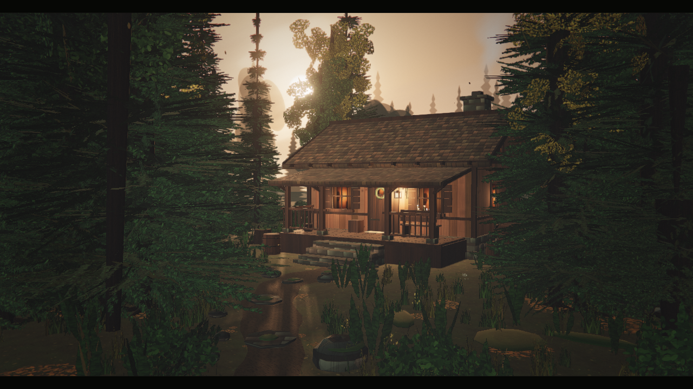
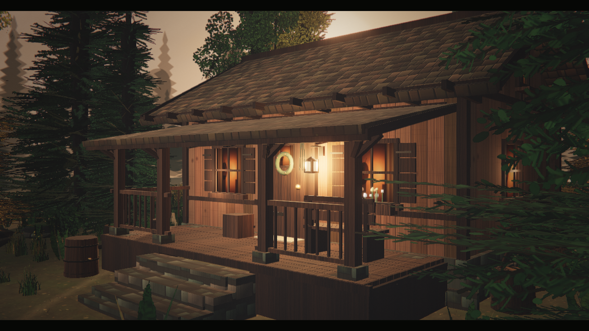
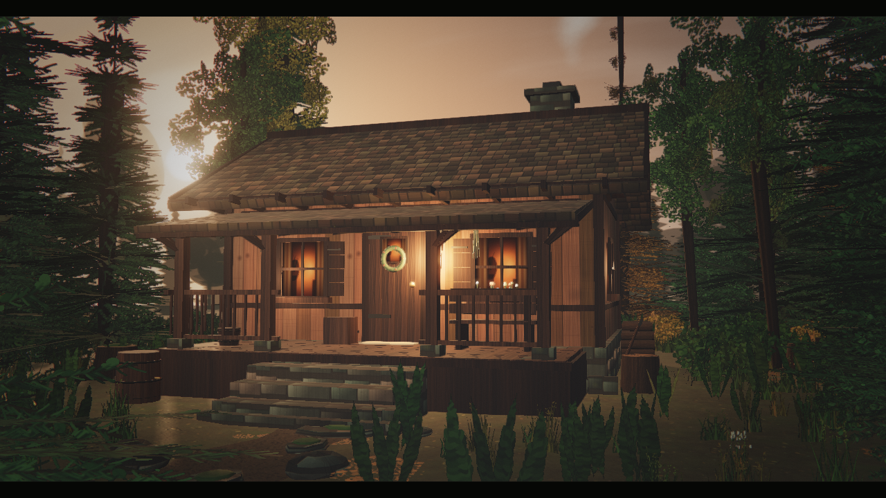
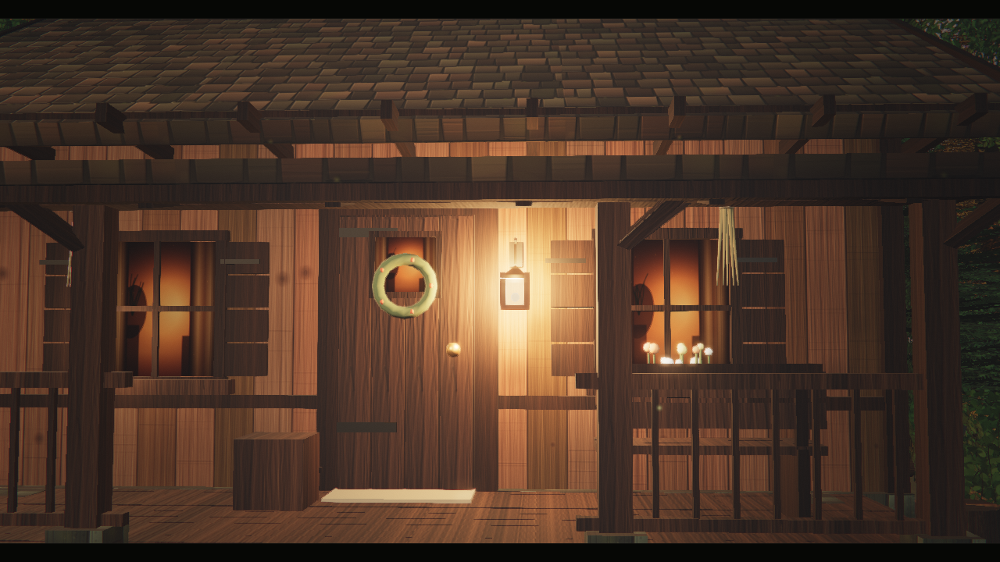
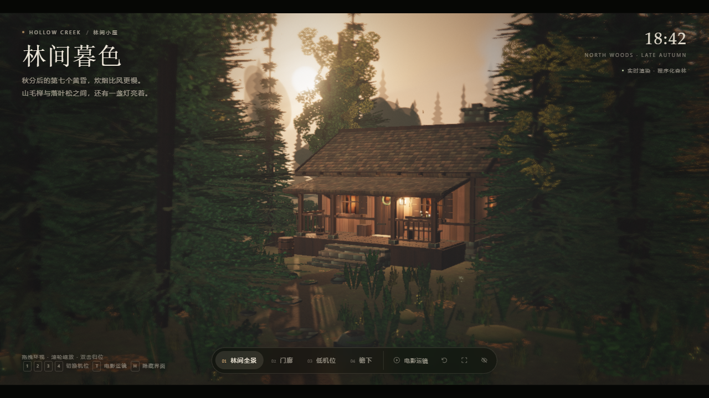

# Hollow Creek · 林间小屋

一个可以直接在浏览器里打开运行的实时 3D 场景：秋日暮色下的森林空地，一间亮着灯的木屋。

场景完全由代码生成，不依赖任何外部模型、贴图或字体文件。最终构建为单个 IIFE 包，`index.html` 双击即可运行，不需要服务器。



## 直接运行

双击项目根目录下的 `index.html`（推荐 Chrome / Edge，需要 WebGL 2）。已用 `file://` 方式验证可直接加载，无需本地服务器。首次打开会先编译着色器与生成程序化贴图，加载页消失后进入 5 秒的推镜开场。

如果希望用本地服务器（例如为了调试），可以：

```bash
npm install
npm run serve
# http://127.0.0.1:5488/
```

## 交互

| 操作 | 效果 |
| --- | --- |
| 拖拽 | 环视场景 |
| 滚轮 / 双指 | 拉近拉远（有限制，不会钻进地面） |
| 双击 | 回到林间全景 |
| `1` `2` `3` `4` | 切换四个机位：林间全景 / 门廊 / 低机位 / 檐下 |
| `T` | 开始或停止电影运镜（硬切章节式转场） |
| `H` | 隐藏界面 |
| `F` | 全屏 |
| `R` | 重置视角 |
| `Esc` | 停止运镜并恢复界面 |

界面底部的机位导航、电影运镜、重置、全屏、隐藏按钮与键盘等效。

## 画面构成

- **木屋**：深色木板墙、厚木梁柱、石砌基座与烟囱、木瓦屋顶、门廊与石阶、门廊灯、花环、柴堆、木桶、长凳与室内暖光。窗格、百叶、檐下椽头、屋脊压条等构件独立建模，避免“方块盒子”感。
- **森林**：程序化冷杉、白桦与落叶松，近中景为真实几何 + 叶片卡，远景为一圈手绘森林剪影，兼顾层次与性能。草、蕨、灌木、苔藓、野花、蘑菇、倒木、树桩与落叶均使用实例化绘制。
- **光照**：低角度逆光太阳（暖色）、天空半球光、冷色补光、门廊暖灯与窗光；2048 阴影贴图、PMREM 环境反射、指数雾和远景剪影共同形成空气透视。
- **后期**：HDR 半浮点渲染 → 景深 → Bloom → 自定义电影调色（ACES 色调映射、分离色调、S 曲线、暗角、颗粒、轻微色差）→ FXAA。所有调色在最终 Pass 完成，避免二次色彩空间转换。
- **动态**：树冠与草丛随风摆动，烟雾、尘埃、萤火与飘落的叶子；相机开场推镜和章节式运镜。

## 性能

- 植被、落叶、石块等全部实例化；远景使用剪影替身，3D 树只保留在相机约 27 米内。
- 默认按设备像素比渲染并封顶；连续低帧率时会自动降低 DPR、关闭景深并降低 Bloom。
- URL 参数：
  - `?quality=low`：关闭景深、降低阴影与雾密度，适合集成显卡或调试。
  - `?quality=high`：更高 DPR 上限和更细的颗粒。
  - `?render=1`：隐藏全部 HUD，用于截图/录制。
  - `?t=24`：把场景时间固定在第 24 秒，便于复现同一帧。

## 工程结构

```
index.html            页面骨架、HUD 与加载层
bundle.js             esbuild 打包后的运行文件（由 src 生成）
src/
  main.js             启动、相机、机位、运镜、灯光、性能自适应
  lib.js              数学、噪声、几何与实例化工具
  textures.js         全部程序化 Canvas 贴图
  materials.js        PBR 材质与风摆动着色器注入
  sky.js              黄昏天空、太阳、云与环境贴图
  terrain.js          地形、碎石小径、石块、倒木
  forest.js           针叶/阔叶树、灌木、草蕨、落叶与远景
  cabin.js            木屋、门廊、室内与灯光
  effects.js          烟、尘埃、萤火、落叶
  post.js             景深、Bloom、调色与 FXAA
tools/
  build.mjs           esbuild 构建
  serve.mjs           本地静态服务器
  shot.mjs            无头浏览器截图
  ui.mjs              带 HUD 的截图
  filetest.mjs        file:// 打开验证
```

## 构建

```bash
npm install
npm run build
```

构建使用 esbuild 将 `src/main.js` 及其依赖打包为浏览器可直接执行的 IIFE，输出 `bundle.js`。开发时可使用 `node tools/build.mjs --dev` 生成未压缩版本与内联 sourcemap。

## 浏览器要求

- 支持 WebGL 2 的现代桌面浏览器；独立显卡或较新的集成显卡体验最佳。
- 不支持 WebGL 2 时页面会显示错误提示，而不是黑屏。
- 字体使用系统衬线/无衬线回退，不加载网络字体。

## 截图

| 全景 | 门廊 | 低机位 | 檐下 |
| --- | --- | --- | --- |
|  |  |  |  |

带 HUD 的界面：


